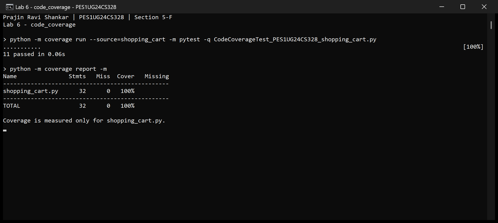

# Lab 6: Shopping Cart Coverage Analysis

Name: Prajin Ravi Shankar  
SRN: PES1UG24CS328  
Section: 5-F

## Code coverage

The two starter tests executed 14 of the application's 32 statements (43.75%,
shown as 44% in the terminal). They did not test cart discounts, invalid inputs,
bulk discounts, paid shipping or express shipping.

The code coverage suite has 11 cases. It checks all three GST categories,
unknown categories, negative prices, bulk discounts, all three cart discount
slabs and the express shipping charges. All 32 statements execute, giving
100% line coverage with no missing lines.



## Run the tests

Run these commands from the `Lab 6` directory with Python 3 installed:

```text
python -m pip install -r requirements.txt
python -m coverage run --source=shopping_cart -m pytest -q CodeCoverageTest_PES1UG24CS328_shopping_cart.py
python -m coverage report -m
```

The source filter measures the application only, so executing test code does
not inflate the coverage percentage. The application and starter tests are
unchanged. Expected values follow the supplied application's floor-division
rules for GST and discounts.
