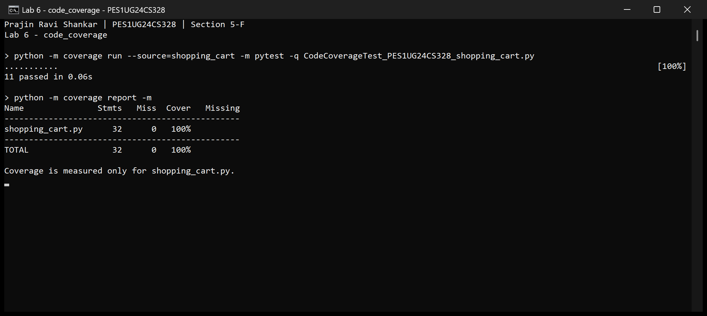
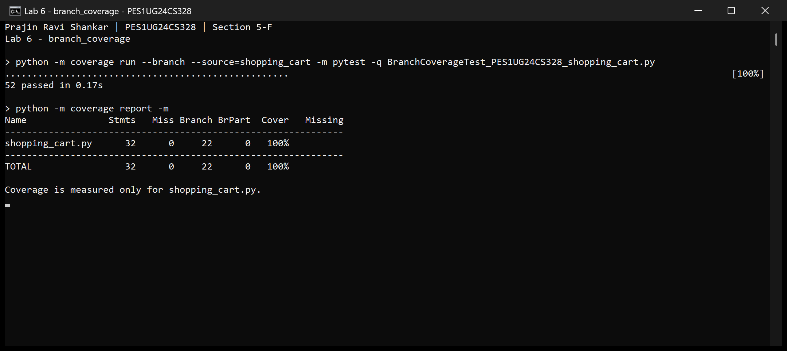

# Lab 6: Code and Branch Coverage

**Name:** Prajin Ravi Shankar  
**SRN:** PES1UG24CS328  
**Section:** 5-F

## Application and workflow

Assigned repository: [L6_L7_23_shopping_cart](https://github.com/SETAPESU26/L6_L7_23_shopping_cart).

The assigned repository was cloned locally. Its `Lab 6/shopping_cart.py` and
starter tests were used for this exercise. The application calculates item
totals with GST and bulk discounts, cart discounts, and shipping charges.

The starter tests were run with line coverage and branch coverage first.
Separate test suites were then added, run and committed with their terminal
screenshots. The completed work was uploaded to this repository under `Lab 6`.
The application and starter test file are unchanged from the assigned repository.
No changes were uploaded to the assigned SETAPESU26 repository.

## Results

| Test suite | Passed | Line coverage | Branch coverage |
|---|---:|---:|---:|
| Starter tests | 2 | 14/32 = 43.75% | 6/22 = 27.27% |
| Code coverage tests | 11 | 32/32 = 100% | 20/22 = 90.91% |
| Branch coverage tests | 52 | 32/32 = 100% | 22/22 = 100% |

Running all three suites together gives **65 passing tests**. The final suite
has no missing statements or branch outcomes and exceeds the required 90%.

Line coverage checks whether a statement ran. Branch coverage checks the
different outcomes of decisions. The code suite reaches every statement but
misses two outcomes: skipping the Prime cart discount and choosing standard
shipping. The branch suite covers both, along with the boundary cases below.

In branch mode, the terminal report's `Cover` column combines statement and
branch coverage. The branch-only percentages above are calculated from the
covered branch outcomes in the JSON reports.

## Cases covered

- All three GST categories, unknown categories, negative prices and invalid quantities.
- Zero price and quantities 9, 10 and 11 around the bulk-discount threshold.
- Cart values around 2000 and 5000 for the discount slabs.
- Coupon values 999, 1000 and 1001, invalid coupon codes, and Prime combinations.
- Shipping values 499, 500 and 501 with Prime/non-Prime and standard/express options.
- Floor division in the tax and discount calculations.

## Deliverables

| File | Purpose |
|---|---|
| [CodeCoverageTest_PES1UG24CS328_shopping_cart.py](CodeCoverageTest_PES1UG24CS328_shopping_cart.py) | 11 cases for code coverage |
| [BranchCoverageTest_PES1UG24CS328_shopping_cart.py](BranchCoverageTest_PES1UG24CS328_shopping_cart.py) | 52 cases for branch coverage and boundaries |
| [Coverage_Analysis.md](Coverage_Analysis.md) | Before/after comparison and missing-branch analysis |
| [evidence/code_coverage.png](evidence/code_coverage.png) | Final code coverage terminal screenshot |
| [evidence/branch_coverage.png](evidence/branch_coverage.png) | Final branch coverage terminal screenshot |
| [evidence/](evidence/) | Text and JSON reports for the baseline and updated suites |
| [shopping_cart.py](shopping_cart.py) | Original application under test |
| [test_shopping_cart.py](test_shopping_cart.py) | Original starter tests |

Only results above the required coverage threshold have screenshots, as
specified in the handout. Baseline results are saved as text and JSON.

## Run locally

With Python 3 installed, open a terminal in this repository's `Lab 6` directory:

```sh
python -m pip install -r requirements.txt

# Code coverage
python -m coverage run --source=shopping_cart -m pytest -q CodeCoverageTest_PES1UG24CS328_shopping_cart.py
python -m coverage report -m

# Branch coverage
python -m coverage run --branch --source=shopping_cart -m pytest -q BranchCoverageTest_PES1UG24CS328_shopping_cart.py
python -m coverage report -m

# All tests
python -m pytest -q
```

`--source=shopping_cart` measures only the application. `pytest.ini` includes
the required capitalized test filenames in automatic discovery. Each coverage
run replaces the current measurement, so view its report before the next run.

## Required commits

1. [2be5aff - Code coverage tests and terminal screenshot](https://github.com/voke1308/SE-labs-PES1UG24CS328/commit/2be5afff7d895c157244dcfdbefc5126e4775467)
2. [fc13b7c - Branch coverage tests and terminal screenshot](https://github.com/voke1308/SE-labs-PES1UG24CS328/commit/fc13b7ceade79420e870402772513bf0b18f0b3e)

## Terminal output

### Code coverage



### Branch coverage


