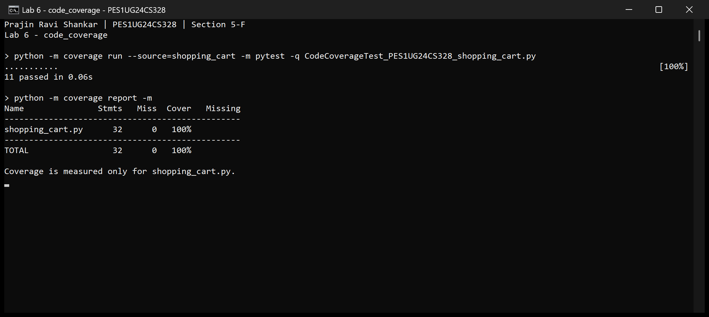
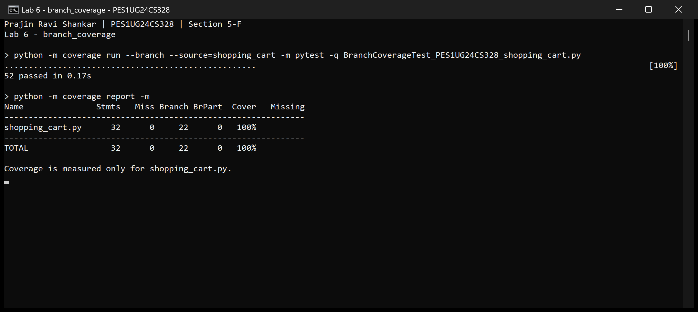

# Lab 6: Shopping Cart Coverage Analysis

Name: Prajin Ravi Shankar  
SRN: PES1UG24CS328  
Section: 5-F

## Code coverage

The two starter tests executed 14 of the application's 32 statements (43.75%,
shown as 44% in the terminal). They did not test cart discounts, invalid inputs,
bulk discounts, paid shipping or express shipping.

The code coverage suite has 11 cases. It checks all three GST categories,
unknown categories, negative prices, bulk discounts, all three cart discount
slabs and the express shipping charges. All 32 statements execute, giving
100% line coverage with no missing lines.



## Branch coverage

Line coverage checks whether each executable statement ran. Branch coverage
also checks the different outcomes of decisions. For example, executing the
Prime discount addition covers its line, but does not test skipping that addition.

Running the code suite with `--branch` finds two missing transitions:

| Transition | Untested outcome | Added test |
|---|---|---|
| 22 -> 24 | `is_prime` is false in `cart_discount` | Non-Prime cart discount cases |
| 36 -> 40 | `is_express` is false in `shipping_fee` | Standard shipping cases |

The branch suite has 52 cases. It also tests quantities 9, 10 and 11; zero and
negative quantities; zero price; discount boundaries 1999/2000/2001 and
4999/5000/5001; coupon boundaries 999/1000/1001; invalid coupons; and all
Prime/express combinations around the shipping threshold 499/500/501.
Separate invalid-price and invalid-quantity cases exercise both operands of
the `or`. Coupon tests cover a wrong code and a correct code below its threshold.

| Suite | Cases passed | Statements covered | Branch outcomes covered | Branch-mode combined coverage |
|---|---:|---:|---:|---:|
| Starter tests | 2 | 14/32 (43.75%) | 6/22 (27.27%) | 37.04% |
| Code coverage suite | 11 | 32/32 (100%) | 20/22 (90.91%) | 96.30% |
| Branch coverage suite | 52 | 32/32 (100%) | 22/22 (100%) | 100% |

In a branch-mode `coverage report`, `Cover` combines statements and branch
outcomes. It is not the branch-only percentage. For the code suite it is
(32 + 20) / (32 + 22), or 96.30%, while branch coverage alone is 20/22, or 90.91%.
The final branch report has zero missing statements and zero partial branches.



Both suites exceed the required 90%. Only the completed suites have screenshots;
the baseline and intermediate runs are retained as text and JSON reports.
The screenshots are actual Windows console captures of fresh test runs, so
their execution times can differ from the saved text runs.

All three application functions are tested. Function coverage measures whether
functions were invoked; path coverage concerns complete execution routes through
the decisions. Full branch coverage does not prove that every path, input or
short-circuit condition has been tested, or that the program has no bugs.

## Run the tests

Run these commands from the `lab6` directory with Python 3 installed:

```text
python -m pip install -r requirements.txt
python -m coverage run --source=shopping_cart -m pytest -q CodeCoverageTest_PES1UG24CS328_shopping_cart.py
python -m coverage report -m
python -m coverage run --branch --source=shopping_cart -m pytest -q BranchCoverageTest_PES1UG24CS328_shopping_cart.py
python -m coverage report -m
python -m pytest -q
```

The source filter measures the application only, so executing test code does
not inflate the coverage percentage. The application and starter tests are
unchanged. Expected values follow the supplied application's floor-division
rules for GST and discounts.

`pytest.ini` includes the required capitalized filenames in automatic test
discovery. A full run executes 65 cases: 2 starter, 11 code and 52 branch cases.
The two required commits separate the code suite and its screenshot from the
branch suite and its screenshot. All work is contained in `lab6`.
